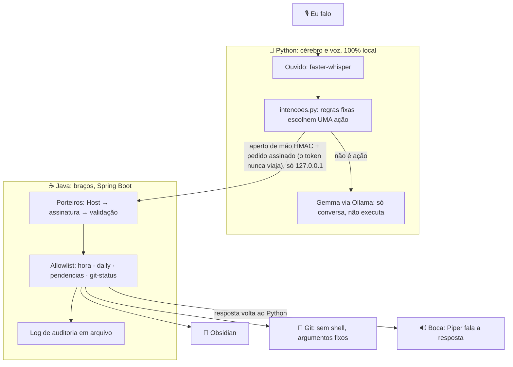
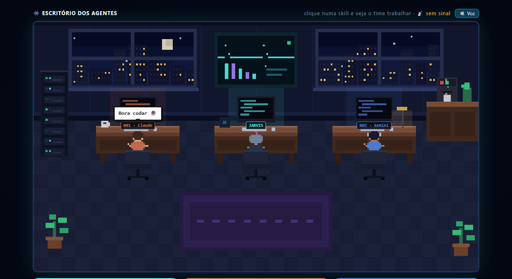

# 🤖 Jarvis 001

[](https://github.com/jjoseffelipe2028/jarvis-001/actions/workflows/testes-java.yml)
[](https://github.com/jjoseffelipe2028/jarvis-001/actions/workflows/testes-python.yml)
[](https://github.com/jjoseffelipe2028/jarvis-001/actions/workflows/codeql.yml)
[](https://github.com/jjoseffelipe2028/jarvis-001/actions/workflows/gitleaks.yml)


**Assistente local com IA offline, em português: Python no cérebro, Java nos braços e segurança em primeiro lugar.**

O Jarvis roda **no meu próprio PC**. Ele me escuta, responde por voz e automatiza minha rotina de estudos (notas do Obsidian, tarefas pendentes, Git), **sem mandar meus dados para a nuvem**.

A regra central: **a IA nunca executa nada direto no computador.** Ela só *pede*, e uma API em Java decide se a ação existe numa lista fechada (allowlist), confere a assinatura do pedido e registra tudo.

---

## ✨ Destaques para quem está avaliando

| | |
|---|---|
| ☕ **API REST em Java 21 + Spring Boot 4** | 9 ações reais, cada uma em camadas (`Controller` → `Service`), com validação e erros padronizados |
| 🔒 **Segurança como requisito** | Pedidos assinados com HMAC (o segredo nunca viaja), anti replay, anti CSRF, anti DNS rebinding, anti Path Traversal, anti injeção de comando, anti log injection |
| 🧪 **339 testes Java + 85 Python** | JUnit 5, unittest + MockMvc + servidor real. Os testes **atacam** a API (truques de URL, `../`, Unicode malicioso, config de git maliciosa) |
| ⚙️ **CI/CD no GitHub** | 4 robôs a cada push: testes Java, testes Python, CodeQL e gitleaks (segredos). Dependabot vigia Maven, pip e Actions |
| 🧠 **IA 100% local** | Ollama + Gemma, faster-whisper e Piper: o áudio nunca sai do PC |
| 🖥️ **Central com escritório ao vivo** | Tela do Jarvis em pixel art: os agentes reagem às ações reais da API e o Jarvis narra por voz local |
| 🛡️ **Sentinela (só avisa)** | Vigia de portas abertas para a rede (`netstat` com comando fixo), vigia de integridade (SHA-256 das travas do projeto) e **detector de golpe brasileiro** (regras explicáveis, nunca abre o link) |
| 📋 **Processo de engenharia** | Cada entrega tem ticket, plano aprovado, revisão de segurança e evidências → [`docs/tickets/`](docs/tickets/) |

## 🏗️ Como funciona



**Por que assim:** se a IA for enganada (prompt injection), ela não tem como agir. Quem escolhe a ação são regras fixas, e o Java só executa o que está na lista.

## 🖥️ Central: a tela do Jarvis



Uma página servida pela própria API em `127.0.0.1`, aberta em **modo app** por um ícone na Área de Trabalho. **100% offline**: nenhuma fonte, imagem ou biblioteca de fora, tudo desenhado em código num `<canvas>`.

- **Botões com ações reais** (pendências, Git, 🛡️ portas, 🔏 travas, 🎣 golpe?) e **cartão de aceite**: nada vai para a IA na nuvem sem o clique em *Aceitar*.
- **📝 Daily pela Central**: a única ação que **escreve**. Passa por *Revisar → Confirmar*; sem `Origin` o pedido é recusado.
- **🎣 Golpe?**: cola uma mensagem suspeita e o Jarvis mostra o nível (baixo/suspeito/alto), os motivos e o que fazer. Só lê o texto.
- **Escritório pixel**: 001, Jarvis e 002 andam, sentam e mostram as skills de cada um.
- **Ao vivo**: quando a voz ou o terminal usam um braço, o Jarvis reage na tela. Um pedido **sem token** aparece como 🚨 *Pedido recusado!*, então a segurança fica visível.
- **Narração por voz**: o Jarvis fala os eventos usando **só a voz local do Windows**. Vozes "online" mandariam o texto para a nuvem, então são bloqueadas.

**Travas da Central:** CSP `default-src 'self'` sem `unsafe-inline`; o navegador **nunca** recebe o token; crachá em cookie `HttpOnly` trocado por uma chave de **uso único**; texto na tela só com `textContent`, nunca `innerHTML`. Um teste lê o próprio código da página para garantir isso (`CentralPaginaTest`).

## ☕ API (braços em Java)

| Método | Rota | O que faz |
|---|---|---|
| `GET` | `/acoes/hora` | Data e hora de Brasília (pública) |
| `POST` 🔒 | `/acoes/daily` | Escreve uma linha no daily de hoje do Obsidian |
| `GET` 🔒 | `/acoes/pendencias` | Tarefas abertas (`- [ ]`) dos últimos 7 dailys |
| `GET` 🔒 | `/acoes/git-status` | Diz se o repositório tem algo sem commit (só números) |
| `POST` 🔒 | `/acoes/video/avaliar` | Vídeos V1: decide se o vídeo merece dublagem ("Laboratório Brasil") |
| `POST` 🔒 | `/acoes/video/relatorio` | Vídeos V2: analisa a retenção e grava erros + ajustes no Obsidian |
| `GET` 🔒 | `/acoes/sentinela/portas` | Sentinela: portas abertas para a rede, com risco e nota (só avisa) |
| `GET` 🔒 | `/acoes/sentinela/integridade` | Sentinela: as travas do projeto mudaram desde que a API ligou? (SHA-256) |
| `POST` 🔒 | `/acoes/sentinela/golpe` | Sentinela: essa mensagem tem cara de golpe? (PIX, falso parente, link disfarçado; nunca abre o link) |
| `GET` | `/acoes/prova` | Aperto de mão: prova (HMAC) que esta é a API verdadeira, antes de qualquer pedido |

**Rotas da Central** (só leitura, atrás do crachá): `POST /central/sessao` (chave de uso único → crachá), `GET /central/acoes/pendencias`, `GET /central/acoes/git-status` e `GET /central/acoes/eventos` (o quadro de eventos do escritório, só na memória, com nomes fixos).

Detalhes, exemplos e como rodar: [`java/README.md`](java/README.md).

## 🔒 Segurança: ameaça → defesa → prova

| Ameaça | Defesa | Prova (teste) |
|---|---|---|
| Site malicioso chamando a API pelo navegador (CSRF) | Token secreto em **todo** `/acoes/**`, fechado por padrão, comparado em tempo constante | `TokenInterceptorTest`, `RotasPostContratoTest` |
| DNS rebinding | Só aceita `Host` = `localhost` / `127.0.0.1` | `HostInterceptorTest` |
| Truques de URL para furar o porteiro (`//`, `%2F`, `/../`) | Lista pública com comparação **exata** | `TruquesDeUrlServidorRealTest` (Tomcat de verdade) |
| Ler/escrever fora da pasta (Path Traversal) | Pasta só da config, nome de arquivo gerado pelo servidor, `normalize` + `startsWith`, sem seguir atalhos | `DailyServiceTest`, `PendenciasServiceTest` |
| Injeção de comando | Comando `git` **fixo**, sem shell, sem variáveis `GIT_*` de fora, tempo e saída limitados | `GitStatusServiceTest` |
| `.git/config` malicioso executando programa | `core.fsmonitor` desligado no comando | ataque real no teste: o git cru executa, o Jarvis não |
| Markdown/HTML ativo na nota (imagem que vaza IP, DataviewJS) | Texto "desarmado" com `\` | `DailyServiceTest` |
| Log injection | `LogSeguro.limpar()` + teste que lê o código-fonte | `LogSemDadoCruTest` |
| Programa impostor na porta 8080 se passando pela API | Aperto de mão (challenge-response com HMAC): sem a prova, o Python não manda nada | `ProvaControllerTest`, `test_bracos.py` |
| Pedido copiado, repetido ou alterado no caminho | **O token nunca viaja**: cada pedido vai assinado (HMAC + hora + nonce de uso único) | `AssinaturaTest`, `AssinaturaDePontaAPontaTest` |
| Outro site colocando a Central num iframe (clickjacking) | `X-Frame-Options: DENY` + `frame-ancestors 'none'` em toda resposta; ações com `no-store` | `CabecalhosSegurancaFilterTest` |
| Página da Central virando porta de entrada (XSS, script de fora) | CSP trancada, sem script embutido, só `textContent`, nada da internet | `CentralPaginaTest` |
| Outro site usando a sessão da Central | Crachá `HttpOnly` + cabeçalho próprio + `Origin`/`Sec-Fetch-Site` conferidos | `CentralControllerTest` |
| Site de fora escrevendo no cofre pela Central | Crachá `SameSite=Strict` + cabeçalho próprio + **`Origin` obrigatório na escrita** + *Revisar → Confirmar* | `CentralDailyControllerTest` |
| Injeção de comando na Sentinela / `netstat` travado | Comando **fixo** pelo caminho completo, sem shell, 8 s e 512 KB, um por vez | `PortasServiceTest` |
| IA enganada ou vírus desligando as travas (`CLAUDE.md`, hook, config) | Vigia de integridade: SHA-256 das 5 travas, lista fixa, sem seguir atalho | `IntegridadeServiceTest` |
| Mensagem de golpe virando ataque (link aberto, XSS, regex travado, texto no log) | Detector nunca abre link; resposta só com textos fixos; 4000 caracteres e 10 links no máximo; log só com o nível | `DetectorDeGolpeTest` (inclui ReDoS) |
| Mensagem colada mandando o Jarvis agir ("faz um PIX e apaga") | O pedido de golpe é conferido antes de tudo e o resto da frase nunca vira ação | `test_intencoes.py` |
| Narração vazando texto para a nuvem | Só voz com `localService === true`; frases fixas, nunca texto da API | `CentralPaginaTest` + teste no navegador |
| Vazamento de dado pessoal | Respostas e logs sem caminho, sem texto do usuário e sem stack trace | testes de controller |

Revisões de segurança registradas: [`docs/reviews/`](docs/reviews/) e nas fichas de cada ticket.

**Revisão OWASP Top 10 (2025):** 9 ✅ · 1 🟡 em melhoria, cada item com o arquivo da defesa → [`docs/seguranca-owasp.md`](docs/seguranca-owasp.md). Histórico varrido com **gitleaks**: 0 segredos.

## 🧰 Tecnologias

| Parte | Ferramenta | Roda onde |
|---|---|---|
| Braços | Java 21 + Spring Boot 4.1.2 + Maven | 💻 `127.0.0.1:8080` |
| Testes | JUnit 5, MockMvc, Mockito | 💻 + GitHub Actions |
| Cérebro | [Ollama](https://ollama.com) + `gemma4:e2b` | 💻 local |
| Ouvidos | [faster-whisper](https://github.com/SYSTRAN/faster-whisper) + sounddevice | 💻 local |
| Boca | [Piper](https://github.com/OHF-Voice/piper1-gpl) (voz pt_BR) | 💻 local |
| CI/Segurança | GitHub Actions, CodeQL, Dependabot | ☁️ GitHub |
| Time de IA | Claude Code (001) + Antigravity CLI (002), com revisão cruzada | 💻 |

## 🚀 Como rodar

**API Java** (precisa de Java 21):
```bash
cd java/bracos
./mvnw test              # 283 testes
./iniciar.sh             # carrega o .env e sobe em 127.0.0.1:8080
```

**Central** (Windows): 2 cliques em `Jarvis-Central.bat` → liga a API e abre a tela do Jarvis.

**Cérebro e voz** (Python 3.13 + Ollama com `gemma4:e2b`):
```bash
cd python
python -m venv .venv
source .venv/Scripts/activate   # Git Bash
pip install -r requirements.txt
python chat.py
```

## 🗺️ Roteiro

- [x] Base: cérebro (`chat.py`), ouvido (`ouvido.py`) e boca (`boca.py`), tudo offline
- [x] **Braços em Java**: `hora`, `daily`, `pendencias`, `git-status` · segurança · 158 testes · CI
- [x] Integração voz ↔ Java: pendências, git-status, daily, "bom dia, Jarvis" · pedidos assinados
- [x] **Central v0**: tela do Jarvis em modo app, aberta por um ícone na Área de Trabalho (100% offline)
- [x] Central v1/v2: botões com ações reais, cartão de aceite e escritório pixel com os agentes
- [x] Escritório **ao vivo** (eventos reais da API) + **narração por voz local**
- [x] **Sentinela v1** (só avisa): vigia de portas + vigia de integridade + detector de golpe · daily pela Central · bom dia com a Sentinela
- [ ] Módulos: Vídeos (V3+), Biblioteca offline
- [ ] Dupla 001 + 002 em loop com GitHub Issues
- [x] Revisão OWASP Top 10 + gitleaks + portas testadas pela rede
- [ ] Spring Security

## 👤 Autor

**José Felipe**: estudante de Java Back-end e Cibersegurança (EBAC), em busca da primeira vaga em tecnologia.

## Licença

MIT
